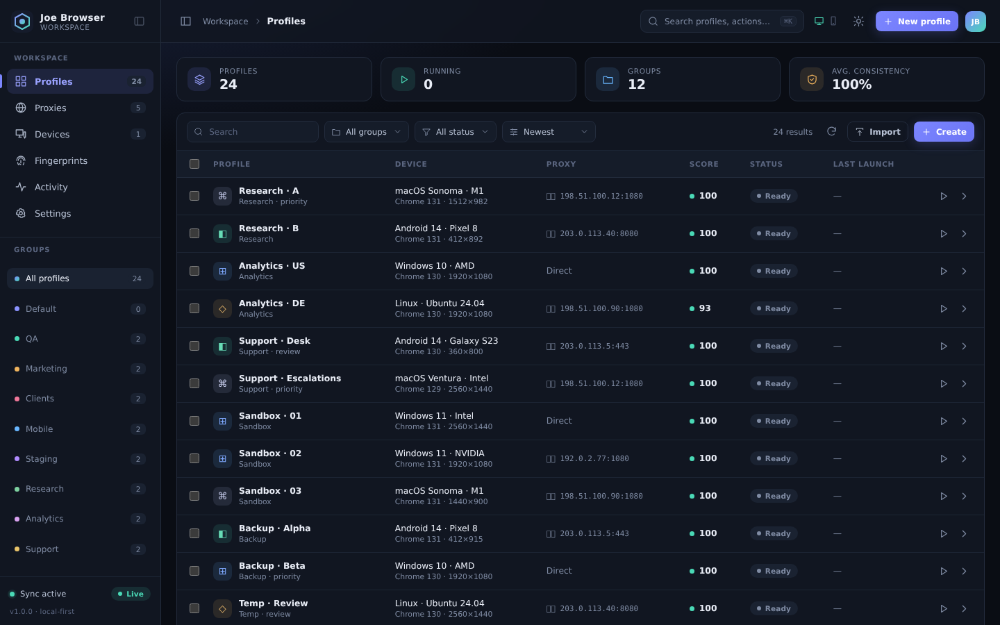
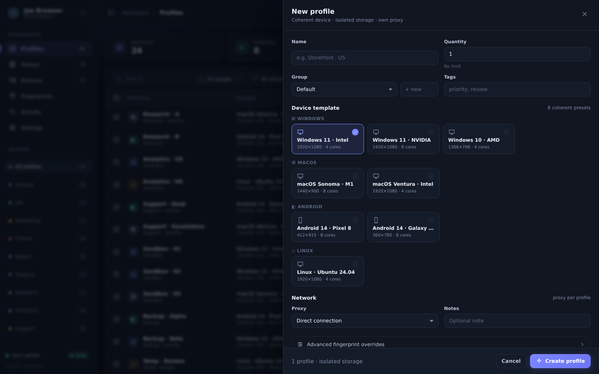
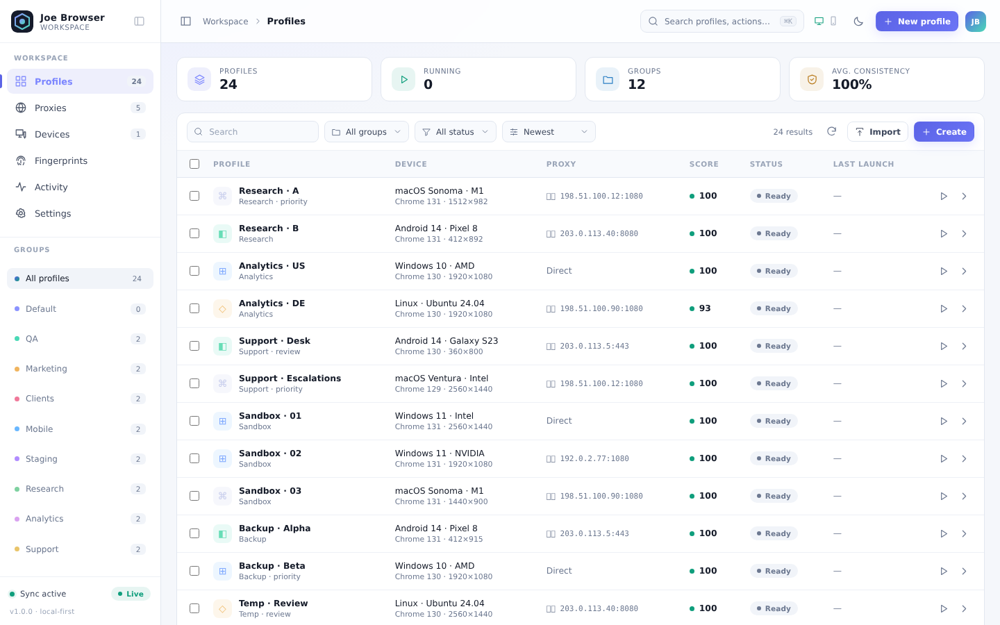
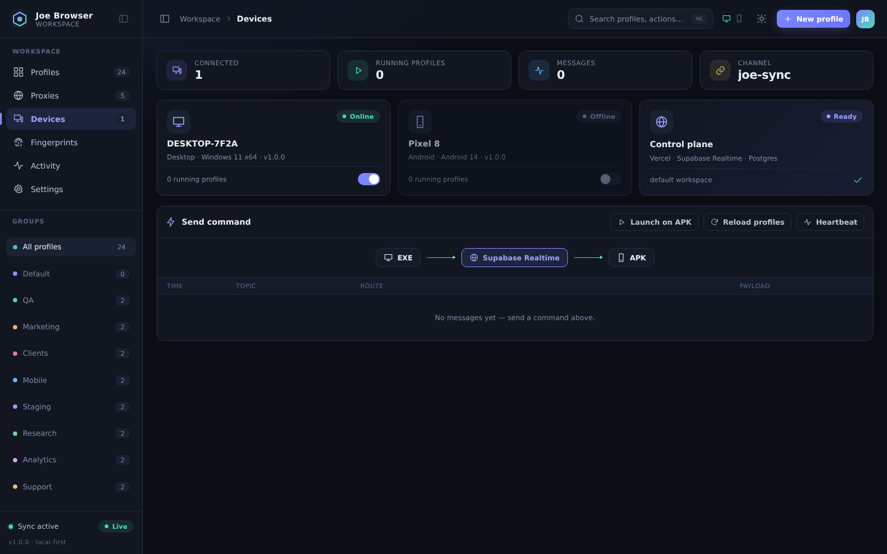
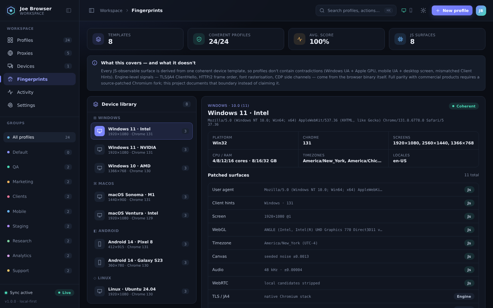
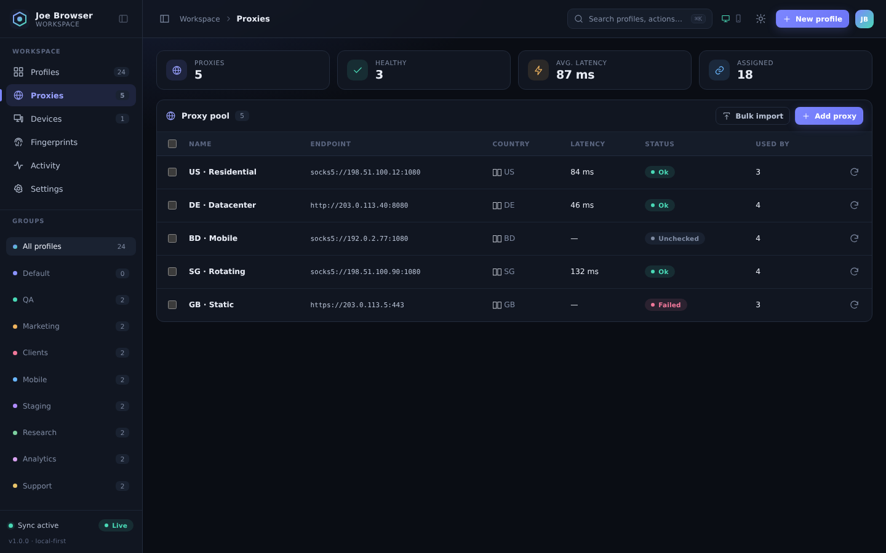
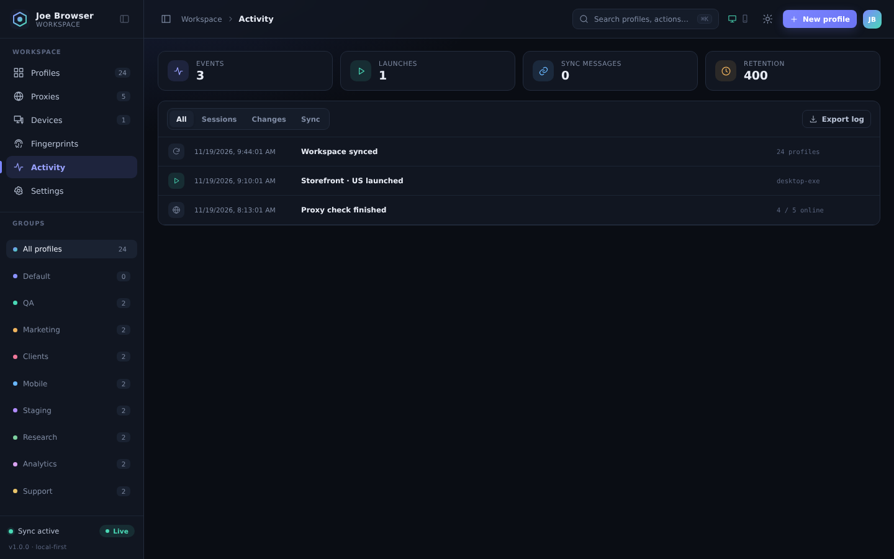
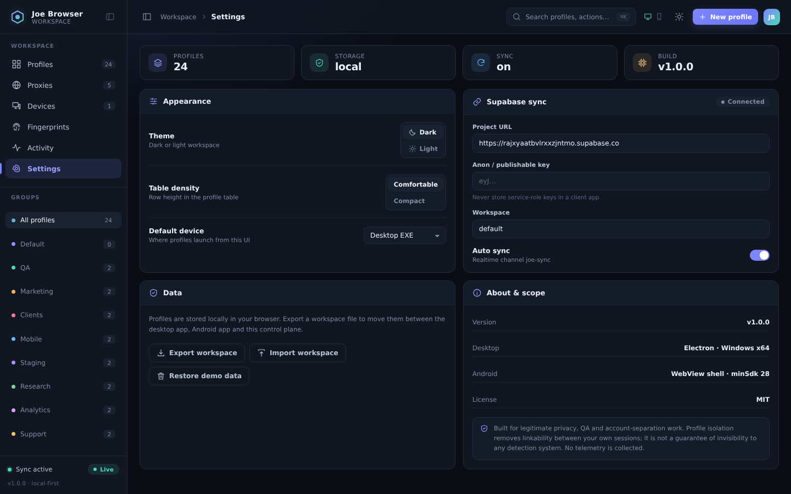

<div align="center">


# Joe Browser

**Unlimited isolated browser profiles for Windows and Android — one codebase, two native apps, synced with Supabase.**

[](https://github.com/pritamsarkar711/Joe-Anti-Detect-Browser/actions/workflows/ci.yml)
[](https://github.com/pritamsarkar711/Joe-Anti-Detect-Browser/releases/latest)
[](LICENSE)
[](#download)

[Download EXE & APK](https://github.com/pritamsarkar711/Joe-Anti-Detect-Browser/releases/latest) · [Live control plane](https://joe-browser-control.vercel.app) · [Architecture](docs/ARCHITECTURE.md) · [Screenshots](#screenshots)

<br/>



</div>

---

## What it is

Joe Browser is an open-source **profile-isolation browser manager**. It creates any number of independent browser identities, each with its own cookie store, cache, localStorage, IndexedDB, proxy and coherent fingerprint specification. The management UI is a single React application that runs in three places: inside the Windows Electron app, inside the Android WebView shell, and on Vercel.

The Windows **EXE** and the Android **APK** stay in sync through **Supabase** (Realtime + Postgres with row-level security) while **Vercel** hosts the control plane and the SEO landing page.

### Download

| Platform | File | Notes |
|---|---|---|
| Windows 10/11 | `JoeBrowser-Setup-1.0.0.exe` | NSIS installer |
| Windows 10/11 | `JoeBrowser-Portable-1.0.0.exe` | Portable, no install |
| Android 9+ | `JoeBrowser.apk` | Signed debug build, sideload |

Get all three from the [latest GitHub Release](https://github.com/pritamsarkar711/Joe-Anti-Detect-Browser/releases/latest), together with `SHA256SUMS.txt`.

> Android: enable "Install unknown apps" for your file manager before sideloading. The APK is signed with a debug key created during the CI build; verify the checksum before installing.

---

## Features

- **Unlimited profiles** — create one or 500 at once; no cap, no seat pricing, no telemetry.
- **True isolation** — Electron `session.fromPartition('persist:<id>')` per profile on desktop; separate `WebView` data directories in dedicated processes on Android.
- **Coherent fingerprints** — 8 device templates derive user agent, Client Hints, platform, GPU, screen, DPR, CPU, RAM, timezone, locale, fonts and WebGL parameters **together**, so profiles never contain contradictions (the #1 reason generated fingerprints get flagged).
- **Consistency checker** — 24 static checks per profile: GPU↔OS, UA↔Client Hints, touch↔OS, screen↔OS, locale↔timezone, hardware plausibility, WebRTC and proxy leaks. Each profile gets a score and actionable hints.
- **JS consistency layer** — one generated payload patches navigator, screen, timezone/Intl, canvas, WebGL, audio, WebRTC candidates, media devices, speech voices, plugins and Client Hints. The same bytes are injected by Electron (CDP `Page.addScriptToEvaluateOnNewDocument`) and Android (`evaluateJavascript`).
- **Per-profile proxies** — HTTP / HTTPS / SOCKS4 / SOCKS5, URL and shorthand parsing, bulk paste import, health/latency checks, country tags, one-click reassignment.
- **Workspace tools** — groups, tags, search (`⌘K` palette), filters, sorting, pagination, bulk launch/stop/export/delete, import/export JSON + CSV, activity log, dark/light theme, compact density.
- **Local REST API** — desktop build exposes `127.0.0.1:9333` (`/health`, `/profiles`, `/profiles/:id/launch`, `/profiles/:id/consistency`) for scripting and agent tooling.
- **EXE ⇄ APK sync** — Supabase Realtime broadcast for commands, Postgres as authoritative state, RLS-scoped tables, an Edge Function validating command envelopes, and a Vercel-hosted control plane.

---

## Screenshots

| Profiles | Create | Consistency |
|---|---|---|
|  |  |  |

| Light theme | Devices / sync | Fingerprint library |
|---|---|---|
|  |  |  |

| Proxies | Activity | Settings |
|---|---|---|
|  |  |  |

All screenshots are captured from the running app by `npm run screenshots` using headless Chromium — no mockups.

---

## Stack

| Layer | Technology |
|---|---|
| Shared core | TypeScript — profiles, device templates, consistency, proxy, transfer, sync |
| Shared UI | React 18 + Vite |
| Desktop | Electron 33 + `electron-builder` (NSIS + portable EXE) + local REST API |
| Android | Java / Android SDK WebView, per-process data dirs, JS bridge, PostgREST sync |
| Backend | Supabase — Postgres, Auth, RLS, Realtime, Edge Functions |
| Hosting | Vercel — SEO landing page / control plane |
| Build | GitHub Actions — Windows runner for the EXE, Ubuntu + Android SDK for the APK |
| Tests | Vitest (18 unit/SSR), headless Chromium (25 real-browser checks), Java parser check |

```
packages/core          deterministic profile model + 8 coherent device templates
packages/fingerprint   JS consistency payload builder
packages/sync          transport-agnostic EXE ⇄ APK sync + Supabase adapter
src/                   React control-plane UI (6 views, drawers, palette, toasts)
apps/desktop           Electron main / preload / REST API / builder config
apps/android           Java sources, manifest, resources, manual APK build script
supabase/              SQL migration
site/                  SEO landing page (meta, OG, JSON-LD, robots, sitemap)
.github/workflows/     CI + binary release pipeline
```

---

## Quick start

```bash
npm install
npm run dev            # live control plane on http://localhost:5173
npm test               # 18 unit + SSR tests
npm run test:ui        # 25 real-browser checks (needs the dev server running)
npm run build          # typecheck + production bundle
npm run screenshots    # regenerate real screenshots
npm run build:core     # bundle the shared TS core for the native shells
npm run build:android-ui && npm run build:assets   # APK assets
npm run build:site     # static SEO site
```

### Binaries

Binaries are built by CI, not committed to the repo. Trigger **Actions → Build and publish binaries → Run workflow** with a tag such as `v1.0.0`. The workflow:

1. builds the shared core, the React UI (desktop + `base:./` Android variant) and the APK assets,
2. builds the NSIS installer + portable EXE on `windows-latest`,
3. compiles / dexes / packages / signs the APK on `ubuntu-latest` with the Android SDK,
4. publishes a GitHub Release with both binaries and `SHA256SUMS.txt`.

---

## Scope — read this

This project is a **privacy, QA and account-separation tool**. It removes linkability between your own sessions and keeps JS-visible fingerprint surfaces internally consistent.

It is **not** "undetectable", and no browser honestly is. Commercial products at the AdsPower / GoLogin / Dolphin tier patch Chromium or Firefox **at the C++ engine level** — Donut ships a proprietary Chromium fork, ShardBrowser patches Chromium's TLS/ClientHello and WebGPU, Camoufox patches Firefox C++ because JS injection is detectable through getter inspection and CDP side channels. Joe Browser does not ship a patched engine. TLS/JA4, HTTP/2 frame order, font rasterisation and CDP side channels come from the underlying browser binary and are listed explicitly as engine-level limitations in the app and in [`docs/ARCHITECTURE.md`](docs/ARCHITECTURE.md).

We will not add features whose purpose is defrauding platforms, evading enforcement or impersonating real people.

---

## License

MIT — see [LICENSE](LICENSE). Ideas were studied from open-source projects such as Donut Browser, Camoufox, ShardBrowser and Fox Profile; all code in this repository was written from scratch.
