<div align="center">


# Joe Browser 3.1

**Isolated browser profiles for Windows, Android and the web — bundled engines, coherent fingerprints, per-profile history.**

[](https://github.com/pritamsarkar711/Joe-Anti-Detect-Browser/actions/workflows/ci.yml)
[](https://github.com/pritamsarkar711/Joe-Anti-Detect-Browser/releases/latest)
[](LICENSE)
[](#download)

[Download EXE & APK](https://github.com/pritamsarkar711/Joe-Anti-Detect-Browser/releases/latest) · [Live control plane](https://joe-browser-control.vercel.app) · [Validation](docs/VALIDATION.md) · [Architecture](docs/ARCHITECTURE.md) · [Research](docs/RESEARCH.md) · [Screenshots](#screenshots)

<br/>

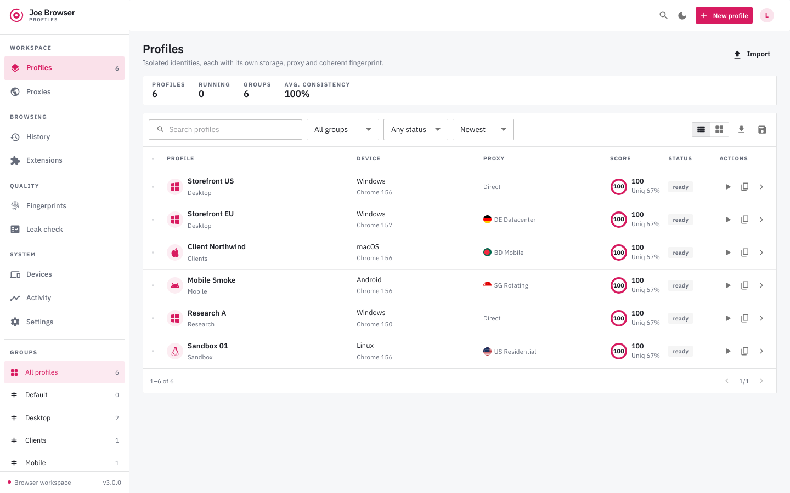

</div>

---

## What it is

Joe Browser is a source-available **profile isolation manager**. Each profile keeps its own cookies, cache, localStorage, IndexedDB, proxy and coherent fingerprint specification. The same React and Material UI workspace runs inside the Windows app, inside the Android WebView shell and on Vercel.

Engines ship **inside** the app: Joe Browser, Chrome, Edge, Brave and Firefox builds are launched from the bundled engine, so a profile never depends on, or connects to, a browser installed on the machine. A new profile opens `https://browserscan.net/` so it can be checked immediately.

The Windows **EXE** and Android **APK** communicate through  **Supabase** — commands flow through a validated edge function that alone holds the service-role key; row-level security keeps clients out of the relay tables.  **Vercel** hosts this SEO site and control plane.  **GitHub Actions** builds and publishes both binaries.

### Download

| Platform | File | Notes |
|---|---|---|
|  Windows 10/11 | `JoeBrowser-Setup-3.1.1.exe` | NSIS installer |
|  Windows 10/11 | `JoeBrowser-Portable-3.1.1.exe` | Portable, no install |
|  Android 9+ | `JoeBrowser.apk` | Signed debug build, sideload |

Get all three from the [latest GitHub Release](https://github.com/pritamsarkar711/Joe-Anti-Detect-Browser/releases/latest), together with `SHA256SUMS.txt`. Android users should enable installation from their file manager and verify the checksum before sideloading.

---

## Plans

| | Free (lifetime) | Premium |
|---|---|---|
| Profiles | **2**, no expiry | Unlimited |
| Engines | Chrome, Joe Browser | Adds **Edge, Brave, Firefox** |
| Fingerprints | Coherent per profile | Advanced classes + observed-device rotation |
| Proxies | Assign + geo match | Plus offline and rotation alerts |
| Extras | History per profile, local probe | Bulk create, import, extension library, paste-as-human typing |

The free limit is enforced in the shared core (`packages/core/src/plans.ts`) — the same in the web UI, the desktop shell and the Android app — **and server-side**: the `guard_account_plan` trigger blocks any client-side plan or limit escalation, and the owner allowlist row resolves to `owner`/`unlimited`. Existing profiles are never removed when a plan changes.

---

## Design system

The interface follows the structure of `dunky11/react-saas-template` while adopting a stricter visual language requested for this project:

- **One primary color:** pink `#D81B60`. No secondary accent, no gradients and no dashed borders.
- **Material UI v5:**  MUI components, `responsiveFontSizes`, 8px spacing and a 2px global radius.
- **Typography:** IBM Plex Sans throughout, loaded locally from `@fontsource/ibm-plex-sans`.
- **Icons:** larger MUI Rounded icons at a 22px default, with  style geometric clarity and circular containers where useful.
- **Official marks:**  Windows,  Android,  Chrome,  Apple,  Linux,  GitHub,  Supabase and  Vercel are shipped as local official SVG marks. All names and marks belong to their owners.
- **Circular flags:** country references use circular national flags inlined as data URIs from `flag-icons` (no stylesheet dependency, no blank placeholders). For example,  Bangladesh is matched to `Asia/Dhaka`, `bn-BD` and local language order.
- **HD responsive:** verified at high device pixel ratios on five Android families. No horizontal overflow, clipped controls or overlapping tap targets were left unfixed.
- **Less text:** duplicate headings, repeated buttons, unused copy and decorative clutter were removed. The interface uses short labels, clear hierarchy and generous spacing.

---

## Features

- **Five bundled engines.** Joe Browser, Chrome, Edge, Brave and Firefox launch from the app's own runtimes with independent fingerprint configuration. No host browser is used or detected.
- **Isolated profiles** with deterministic IDs, groups, tags, status, notes, start URL, cookies, extensions and per-profile launch data.
- **29 observed-device bundles** derived from Apache-2.0 Apify/BrowserForge data, plus 11 curated device classes (Windows 11 Intel/NVIDIA, Windows 10 AMD, macOS Apple-silicon and Intel, Pixel, Galaxy S23, Galaxy Tab S9, iPhone, iPad Pro, Ubuntu). CPU and RAM are drawn as one ordered pair, so a sample is never reported with hardware it never had.
- **Coherent fingerprint specs**: User-Agent, Client Hints, platform, GPU, screen, DPR, CPU, RAM, fonts, timezone, locale, languages, WebRTC mode and touch points are derived together. WebKit (iPhone/iPad) templates keep Safari-shaped UA and brands instead of inheriting Chromium hints.
- **30 region presets** with DST-correct timezone offsets and proxy-to-locale matching. Example:  Bangladesh,  United States,  United Kingdom,  Germany and  Japan.
- **Browsing history per profile**: every URL and search, filterable by profile, copyable and openable.
- **Extension library**: 12 real extensions with per-family store deep links (Chrome, Edge, Firefox), recommended entries and opt-in auto-install.
- **Paste as human**: a reviewed keystroke plan with per-character jitter, word-boundary beats and optional corrections, generated deterministically per seed. On Windows the plan is replayed into the open profile window through CDP with each per-key delay; elsewhere the button copies the plan and says so. It does not solve CAPTCHAs — a person still completes any challenge.
- **Proxy manager**: HTTP, HTTPS, SOCKS4 and SOCKS5, bulk paste, country tags, assignment, health checks, offline/recovery notifications and one-click exit rotation.
- **Quality metrics**: per-profile consistency, uniqueness, entropy, grade, real-backed status and distinct-bundle accounting. Informational engine limits are counted separately from real contradictions. Measured workspace consistency is 100%; measured uniqueness is 77% with grade B. No external score is claimed.
- **Local JavaScript probe**: `22 of 22` internal checks pass for the bundled payload. The app links to independent detectors (IP Fighter, Pixelscan, BrowserScan, AmIUnique, CreepJS, BrowserLeaks) for testing inside a launched profile.
- **Import and transfer**: JSON workspace import/export, CSV profile import/export, cookie JSON or `name=value` import.
- **Bulk operations**: create, duplicate, launch, stop, export and delete above the free limit on Premium; 250-profile creation is covered by the browser smoke suite.
- **Desktop and Android sync**: send / poll / ack through the `joe-command-validate` edge function (payload validated, service-role key server-side only), RLS-scoped Postgres state, event log and device presence.
- **Local REST API**: the Windows app serves loopback endpoints for health, profiles, launch, quality, surfaces and injection script inspection — bound to loopback, token- and origin-gated.
- **Validation views**: quality, observed data, JS surfaces, geo presets and explicit engine-level limits are visible in the app rather than hidden.
- **Accounts**: real Supabase auth — sign-up with email confirmation, sign-in, password reset (paste-link recovery works from `file://`), session persistence and sign-out; entitlement is read from a server-side account row clients cannot escalate. Local sign-in remains available when cloud keys are not configured, and the UI says which mode you are in.

## Screenshots

| Profiles | Create | Detail |
|---|---|---|
|  |  | 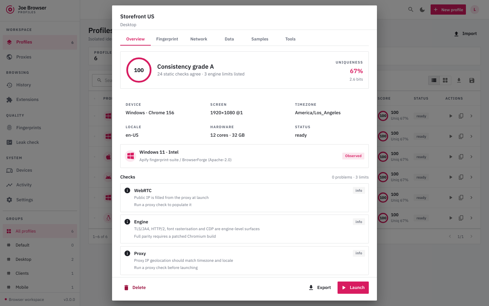 |

| Fingerprints | Live probe | Devices |
|---|---|---|
|  | 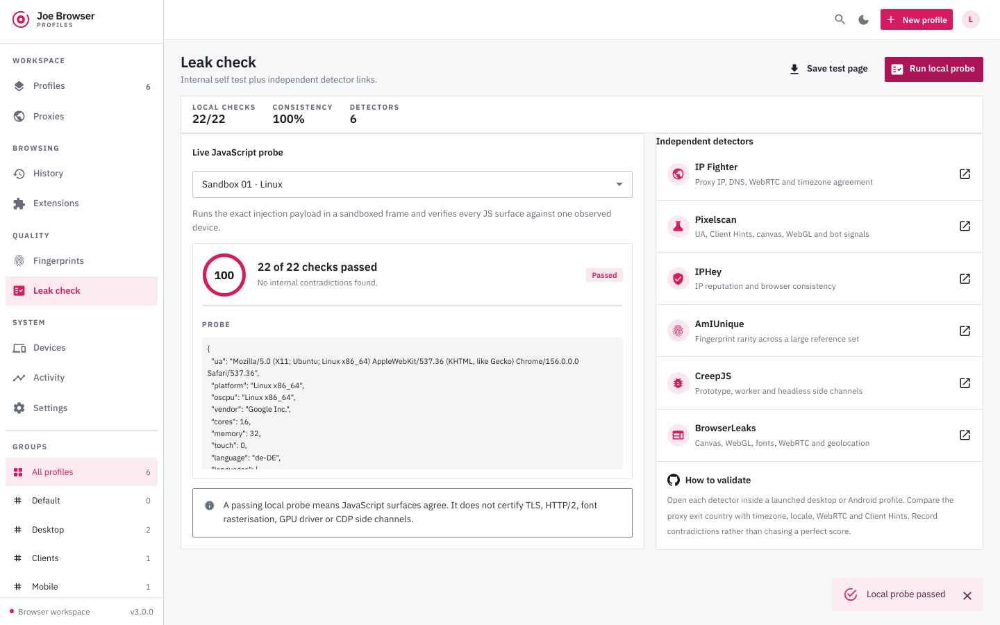 |  |

| Proxies | History | Settings |
|---|---|---|
|  | 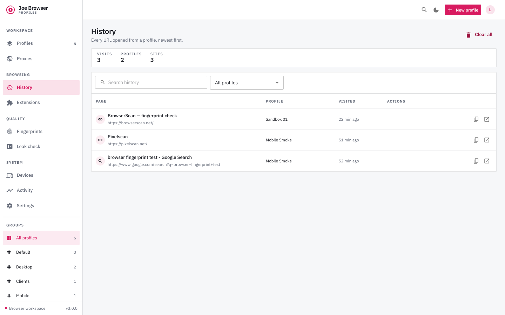 | 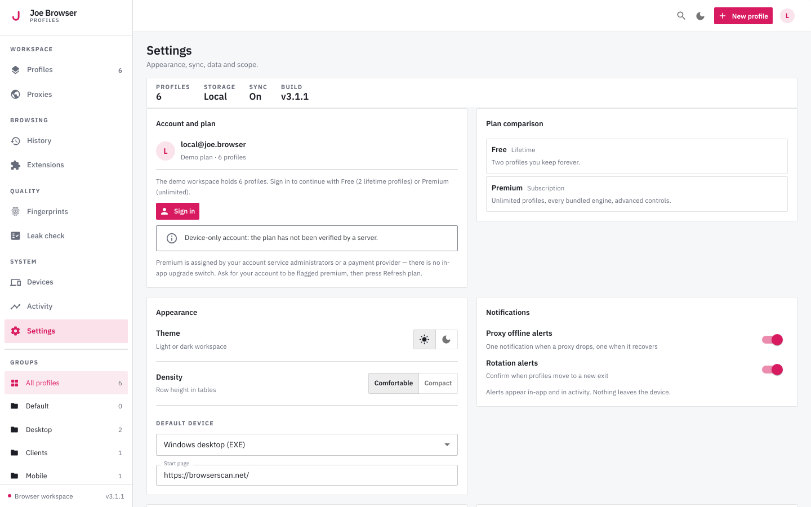 |

| Extensions | Dark theme | Command palette |
|---|---|---|
| 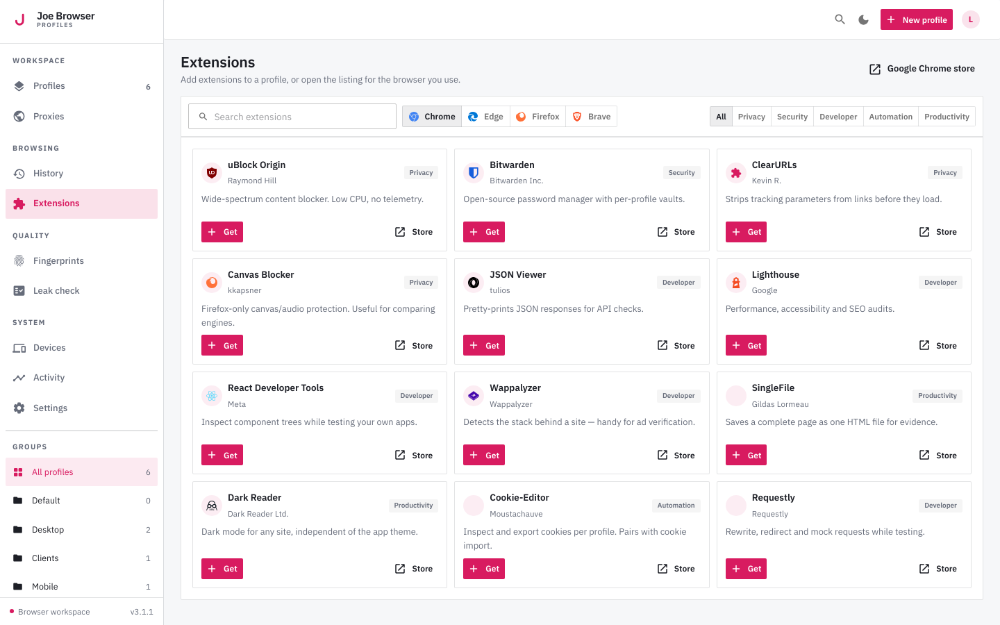 | 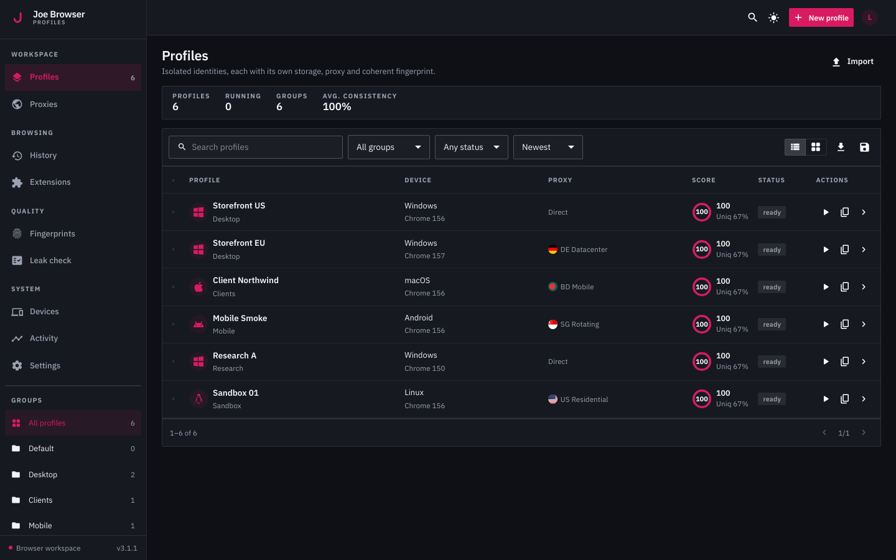 | 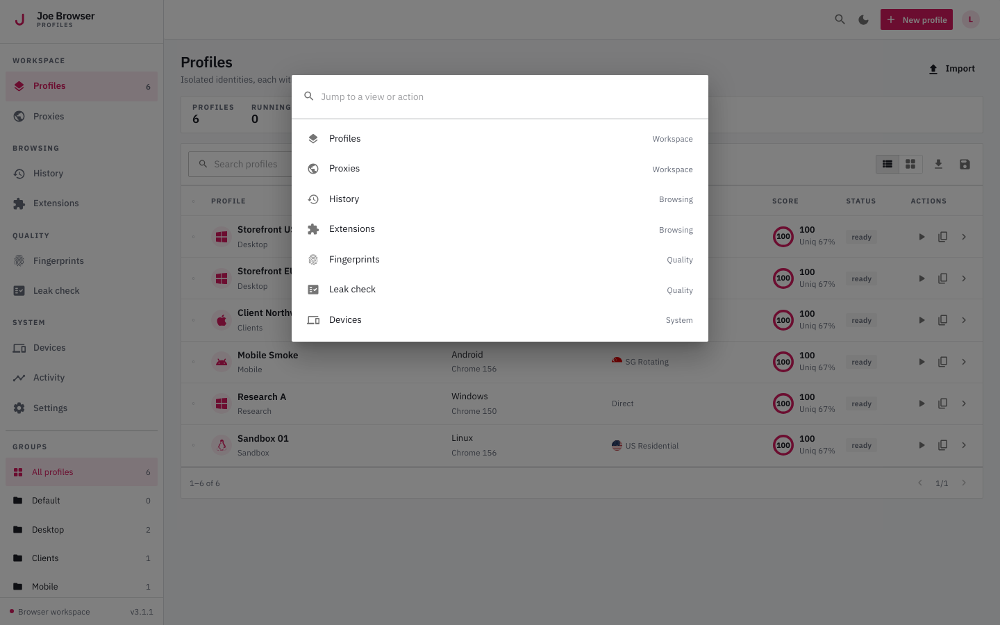 |

### Mobile matrix

|  Pixel |  Xiaomi |  Samsung |  OPPO |  Vivo |
|---|---|---|---|---|
|  | 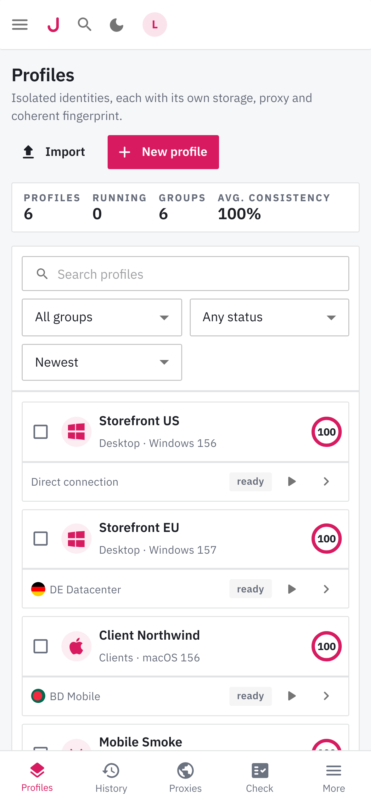 | 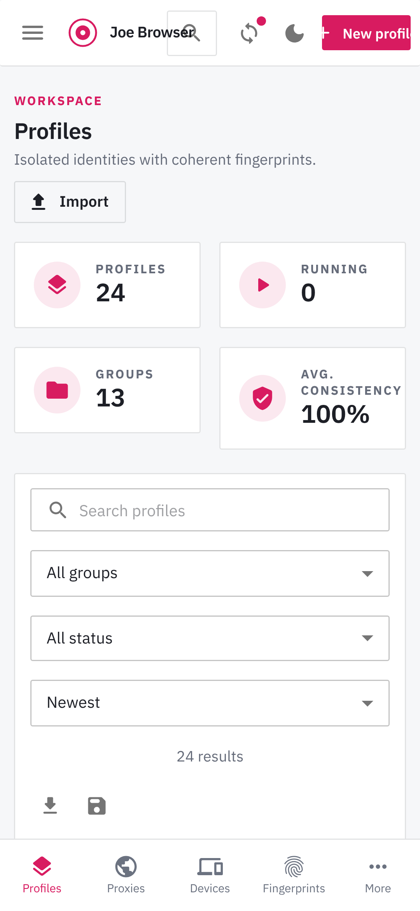 | 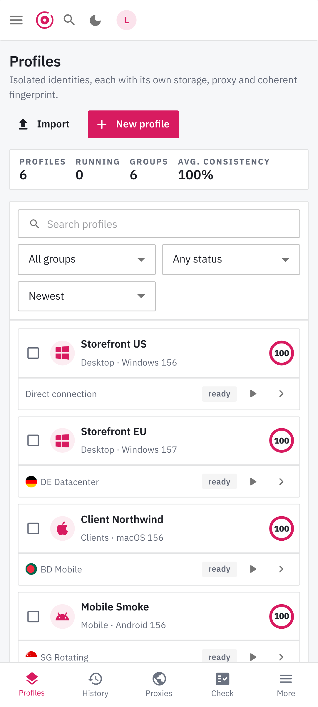 | 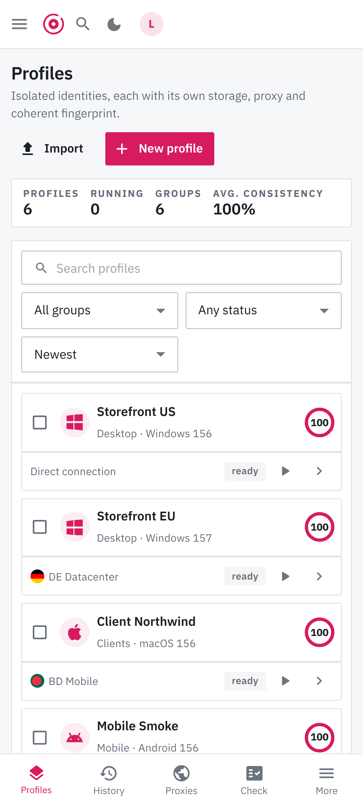 |

All screenshots are captured from the running app by `npm run screenshots` and `npm run test:devices`. The device report is at [`assets/screenshots/devices/report.json`](assets/screenshots/devices/report.json).

---

## Stack

| Layer | Technology |
|---|---|
| Shared core |  TypeScript: profiles, presets, geo, quality, consistency, transfer, sync |
| Shared UI |  React 18 +  Vite +  MUI 5 |
| Desktop |  Electron 33 + `electron-builder` + local REST API |
| Android |  Java / WebView, per-process data dirs, JS bridge, edge-function sync |
| Backend |  Supabase: Postgres, Auth, RLS, Realtime, Edge Functions |
| Hosting |  Vercel static SEO site |
| Build |  GitHub Actions: Windows EXE, Android APK, checksums and release |

```text
packages/core          profile model, 29 observed samples, 30 geo presets, quality
packages/fingerprint   JS consistency payload and local self-test hooks
packages/sync          transport-agnostic EXE ↔ APK sync + Supabase adapter
src/                   MUI workspace: nine views, grouped shell, command palette, toasts
apps/desktop           Electron main, preload, REST API and builder config
apps/android           Java sources, manifest, resources and APK build script
supabase/              SQL migrations + validated edge function
site/                  SEO landing page with local fonts, marks, flags and screenshots
docs/                  architecture, validation and IP protection policy
.github/workflows/     CI + binary release pipeline
```

---

## Quick start

```bash
npm install
npm run dev                 # live control plane on http://localhost:5173
npm test                    # 74 unit and SSR tests
npm run test:fingerprint    # 29/29 injection self-tests + workspace quality
npm run test:ui             # 35 real-browser checks, needs the dev server
npm run test:devices        # 75 checks across five mobile devices, needs dev server
npm run test:java           # Java source parser check
npm run test:site           # static SEO site checks
npm run build               # typecheck + production bundle
npm run screenshots         # regenerate real screenshots
npm run build:core          # bundle the shared TS core for native shells
npm run build:android-ui && npm run build:assets
npm run build:site          # static SEO site
```

Native binaries are built in GitHub Actions, not committed to Git. The release workflow bundles the shared core, builds the Android UI and assets, builds the NSIS and portable EXEs on Windows, compiles and signs the APK on Ubuntu, then publishes a GitHub Release with `SHA256SUMS.txt`. See [`docs/VALIDATION.md`](docs/VALIDATION.md) for the exact current test results and environment limits.

---

## Scope, honestly

Joe Browser is built for **legitimate privacy research, QA/testing, ad verification and separation of your own accounts**. It removes linkability between local sessions and keeps JavaScript-visible fingerprint surfaces internally consistent.

It is **not undetectable**, and no browser honestly is. Commercial AdsPower/GoLogin/Dolphin-tier products and projects such as Donut, ShardBrowser, Camoufox and OVO patch Chromium or Firefox at the C++ engine level. Joe Browser does **not** ship a patched engine. TLS/JA4, HTTP/2 frame order, QUIC, font rasterisation, GPU driver behaviour and CDP side channels come from stock Electron Chromium or Android WebView. Those engine-level surfaces are listed explicitly in the app, in [`docs/ARCHITECTURE.md`](docs/ARCHITECTURE.md) and in [`docs/VALIDATION.md`](docs/VALIDATION.md).

Independent detector hosts were unreachable from this sandbox (`net::ERR_CONNECTION_CLOSED`), so no third-party detector score is claimed. Open the detector links inside a launched native profile and compare proxy exit location, timezone, locale, WebRTC and Client Hints yourself. We will not add fraud, enforcement evasion, ban evasion or impersonation features.

---

## License, copyright and brand

The source code is MIT licensed. Copyright © 2026 Pritam Sarkar and contributors. See [`LICENSE`](LICENSE), [`NOTICE`](NOTICE) and [`TRADEMARK.md`](TRADEMARK.md).

A public MIT grant permits source forks with attribution. It cannot legally ban copying or redistribution. To protect identity and provenance, brand assets and written documentation are governed separately, every official mark is attributed, releases carry checksums and build provenance, contributors certify ownership under a DCO, and false ownership or endorsement claims are expressly prohibited. The full practical strategy is in [`docs/IP-POLICY.md`](docs/IP-POLICY.md). Third-party names and marks belong to their respective owners and are used for identification only.
